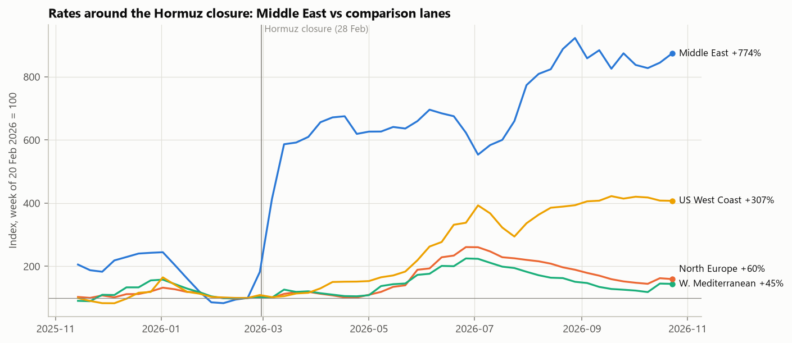
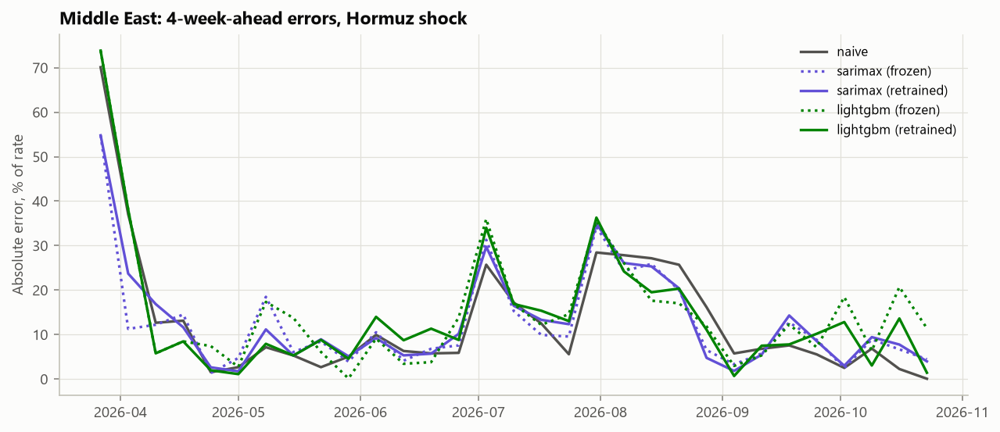
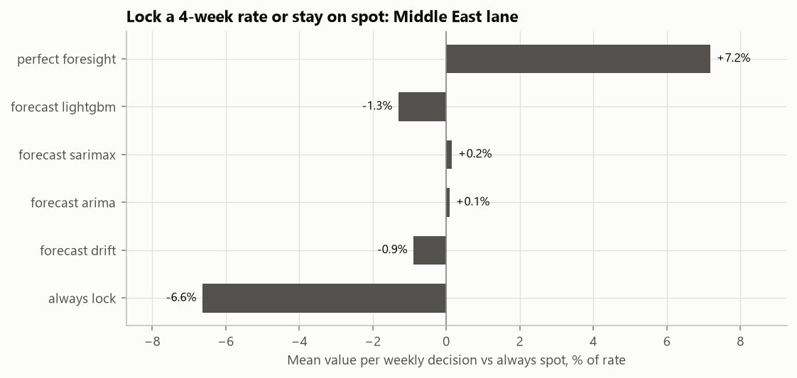

# Container Freight Rate Forecasting

Weekly forecasts of container spot freight rates from Asia to the Middle East (Persian Gulf), 1 to 12 weeks ahead, with 80% prediction intervals. The project measures how the 2026 closure of the Strait of Hormuz hit this lane compared with three less exposed lanes (North Europe, West Mediterranean, US West Coast), tests how forecasting models held up through the shock, and illustrates how a pricing team could use the forecasts.

Only public data is used, from March 2019 to October 2026. Full results: [reports/results_report.md](reports/results_report.md).

## The question

How are spot rates on the Gulf lane likely to move over the next 1–12 weeks, how much of the recent movement comes from the Hormuz closure and through which channel (fuel, risk, port disruption), and what should a pricing team do with that information?

## Headline results

**1. The Gulf lane moved first and most, but not alone.** From 20 February to 23 October 2026, the Middle East index rose 774%. The US West Coast rose 307%, mostly from April to June; North Europe rose 60% and the West Mediterranean 45%.



**2. Short horizons can be forecast; the shock itself could not.**
- At 1–2 weeks, ARIMA and SARIMAX errors are 8–10% smaller than "no change" and they call the direction right 63–69% of the time. From 4 weeks on, no model beats "no change".
- No model foresaw the closure jump. Momentum models recovered fastest in the following eight weeks.
- The three public drivers (Brent, geopolitical risk, Gulf port calls) add no measurable accuracy.



**3. Ranges are useful; long-horizon medians are not.**
- After a conformal correction, 80% intervals contain 80–82% of outcomes at every horizon.
- In a lock-or-spot illustration, decisions based on ARIMA or SARIMAX forecasts add about 2% of the rate per decision in calm periods, lose about 4% during the Hormuz shock, and break even overall.



## Explore the results

| Command | Opens | What you can do |
|---|---|---|
| `make dashboard` | Streamlit dashboard, http://localhost:8501 | Eight pages: findings overview, latest forecast per lane, model accuracy (heatmap against "no change", interval checks, drivers), every backtest forecast against the actual outcome, the Hormuz stress test week by week, a scenario explorer with sliders for Brent, risk and Gulf port calls, the pricing illustration, and the monitoring checks. All charts are interactive. |
| `make mlflow` | MLflow interface, http://127.0.0.1:5000 | Every backtest, stress test, scenario, pricing and weekly forecast run, with its settings, metrics (per lane and horizon) and result files; models side by side. |

The dashboard reads only the public files in `reports/`, so it works as soon as the pipeline has run once.

## The four steps of the project

| Step | What was done | Where |
|---|---|---|
| Scope and data | Data audit; NCFI collection from 372 weekly sheets with checks and corrections; three daily drivers; dated event calendar | `scripts/01*`, `scripts/02*`, `src/hff/ncfi.py`, `data/events.csv` |
| Model and evaluate | Weekly panel in DuckDB (SQL); leakage-tested features; rolling-origin backtest of 7 models across 346 weeks, tracked in MLflow; intervals; Hormuz and Red Sea stress tests | `sql/`, `scripts/03`–`07`, `src/hff/`, `tests/` |
| Industrialize | One-command weekly forecast with a fixed champion rule; monitoring of freshness, drift and live accuracy; dashboard; results report | `scripts/11`, `scripts/12`, `app/`, `Makefile`, `reports/` |
| Business adoption | Conditional scenarios and a lock-or-spot pricing illustration for the Gulf lane | `scripts/09`, `scripts/10` |

## Data sources

| Data | Provider | Used for | Terms |
|---|---|---|---|
| [Ningbo Containerized Freight Index (NCFI)](https://www.hellenicshippingnews.com/category/weekly-container-reports-index/), weekly data sheets | Ningbo Shipping Exchange, republished by [Hellenic Shipping News](https://www.hellenicshippingnews.com/); older sheets located through the [Internet Archive](https://web.archive.org/) | Target: weekly rate index (index points) for the four lanes | Publisher's content: values are rebuilt locally by the scripts and not stored in this repository; public files show only percent changes, rebased indices and aggregate metrics |
| [Brent crude oil spot price (`DCOILBRENTEU`)](https://fred.stlouisfed.org/series/DCOILBRENTEU) | U.S. Energy Information Administration, via FRED (Federal Reserve Bank of St. Louis) | Fuel cost | Cite FRED and the original source |
| [Geopolitical Risk Index, daily](https://www.matteoiacoviello.com/gpr.htm) | Caldara, D. and Iacoviello, M. (2022), "Measuring Geopolitical Risk", *American Economic Review* 112(4) | Geopolitical risk | Cite the paper |
| [IMF PortWatch daily port calls](https://portwatch.imf.org/) | International Monetary Fund, from satellite ship-tracking (AIS) data | Port activity at Ningbo, Jebel Ali and Dammam | Cite IMF PortWatch |
| [Event calendar](data/events.csv) | Compiled for this project; each event links to its own source | Dates of shocks (COVID, Ever Given, Red Sea, Hormuz) | — |

## Setup

Requirements: [uv](https://docs.astral.sh/uv/) and GNU `make`.

```
uv sync
```

This installs Python 3.12 and the exact package versions recorded in `uv.lock`.

## Commands

| Command | What it does |
|---|---|
| `make all` | Every step from the downloads to the pricing illustration (the first run takes several hours, see below) |
| `make weekly` | Weekly routine: new data, panel, champion forecast snapshot, health checks |
| `make data` | Downloads the public data and builds the cleaned tables |
| `make panel` | Builds the weekly panel in the DuckDB warehouse |
| `make eda`, `make baselines`, `make models`, `make stress`, `make scenarios`, `make pricing` | One analysis step each (the two backtests take about 20 minutes together) |
| `make forecast`, `make monitor` | Weekly forecast snapshot; monitoring checks |
| `make dashboard`, `make mlflow` | Interactive dashboard; MLflow interface (see above) |
| `make check` | Lint and unit tests, as in the CI |

The NCFI collection waits 30 seconds between requests to the news site, as its `robots.txt` asks, so the first run takes several hours; later runs only fetch new weeks. Every downloaded file is listed in `data/raw/manifest.csv` with its source URL, retrieval time and checksum.

## Project structure

```
config/config.yaml   settings and notation: lanes, horizons, quantiles, dates, model settings
data/events.csv      dated shipping events, each with a source URL
data/                raw, interim and processed data (not tracked; rebuilt by the scripts)
sql/                 SQL transformations for the local DuckDB warehouse
scripts/             numbered pipeline scripts, run in order by make
src/hff/             shared code: NCFI parser, features, models, metrics, backtest, charts, tracking
app/                 Streamlit dashboard (one file per page in app/views/)
tests/               unit tests (parsing, leakage, metrics, backtest, configuration, events, dashboard)
reports/             results report, figures, result tables, weekly forecast snapshots
```

## Status

Complete: data, models, stress test, scenarios, pricing illustration, weekly forecast, monitoring, MLflow tracking and the dashboard, all run locally. The weekly forecast runs with `make weekly`, and each snapshot is kept unchanged in `reports/forecasts/` to build a live track record. Next: deploying the dashboard.
