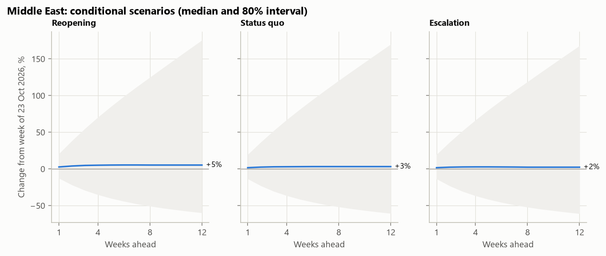

# Forecasting container spot rates through the Hormuz closure

**Results report** · 28 October 2026 · data to the week ending 23 October 2026

Weekly spot rates from Ningbo to the Middle East (Dammam and Dubai), forecast 1 to 12 weeks ahead with 10/50/90% quantiles, and compared with three lanes less exposed to the Gulf: North Europe, West Mediterranean and US West Coast. All figures are in `reports/figures/`; every number below is reproduced by `make all`. The same results can be explored interactively in the dashboard (`make dashboard`), and every run is recorded in MLflow (`make mlflow`).

## Summary

1. **The shock.** From the week before the rise (20 February 2026) to 23 October, the Middle East index rose 774%, with a peak of +823% on 28 August. The first 82% came in the week ending 27 February, the day before the closure of the Strait of Hormuz. The comparison lanes moved later and less, except the US West Coast (+307%).
2. **Short horizons can be forecast, long ones cannot.** At 1 and 2 weeks, ARIMA and SARIMAX errors are 8–10% smaller than the naive forecast ("no change") on the Middle East lane, and they call the direction right 63–69% of the time, against 50–52% for always predicting the more frequent direction. From 4 weeks on, no model beats "no change".
3. **The public drivers add no measurable accuracy.** SARIMAX (ARIMA plus Brent, geopolitical risk and Gulf port calls) scores the same as ARIMA; no driver coefficient is statistically different from zero, and no driver change leads the rate.
4. **Calibrated intervals are achievable.** After widening LightGBM's intervals from its own past misses, 80–82% of outcomes fall inside the 80% intervals on the Middle East lane at every horizon. Widened LightGBM has the best interval scores at 1–2 weeks, and SARIMAX from 4 weeks.
5. **No model saw the jump coming; momentum models recovered first.** In the first week after the closure, one-week forecasts missed by 43–57% of the rate. Over the first 8 weeks, ARIMA and SARIMAX one-week errors averaged 11–12% against 14.5% for "no change"; after two months all models were back to the accuracy of "no change". Retraining every week made almost no difference.

**For a pricing team:** the 1–2 week forecasts and the 80% ranges are usable; beyond 4 weeks the median is no better than today's rate, and the range carries the information. In the first weeks of a shock, judgement and risk limits matter more than any model trained on public data.

---

## 1. Data

| Input | Source | Use |
|---|---|---|
| NCFI weekly route values, March 2019 to October 2026 | Ningbo Shipping Exchange data sheets, collected from Hellenic Shipping News and the Internet Archive | Target: 4 lanes, 397 weeks each |
| Brent crude, daily | FRED `DCOILBRENTEU` (EIA) | Fuel cost channel, known with a 1-week delay |
| Geopolitical Risk Index, daily | Caldara and Iacoviello (2022) | Risk channel, 1-week delay |
| Container port calls, Jebel Ali + Dammam, daily | IMF PortWatch (AIS-based) | Gulf disruption channel, 2-week delay |
| Event calendar | `data/events.csv`, 12 dated events with sources | Shock flags and evaluation periods |

**Quality checks.**
- All 372 data sheets were read, and every printed weekly growth matches its two printed values.
- Three weeks were printed at exactly twice their level on all 22 routes (May 2020, February 2024, October 2024); they are corrected from the next sheet.
- Three weeks have no sheet anywhere.
- 28 values were compared with figures published elsewhere (the exchange's written commentary, worldports.org), and all are equal.

**Leakage rules.**
- Features use only the value printed on the sheet of each week; later corrections are used only as targets.
- Drivers are shifted by their publication delay.
- Event flags switch on at the event date.
- Unit tests check each rule.

**What this report shows.** NCFI values are the publisher's content, so they are shown only as percent changes, rebased indices and aggregate metrics.

## 2. What happened to rates

1. **The Middle East moved first and most.** The index rose 82% in the week ending 27 February and 127% the week after. By the end of March it stood 510% above the week of 20 February.
2. **A second rise came in July and August.** From its early-June high, the Middle East index fell 20% by 3 July, in the weeks after a reopening was announced (18 June). It then rose to its peak (+823%, 28 August) after the interim truce ended (8 July) and the naval blockade was reinstated (14 July). These dates coincide with the moves; the data cannot show cause.
3. **Europe and the Mediterranean reacted late and temporarily.** They were up about 20% at the end of March and peaked on 26 June (+161% and +125%). They have since fallen back to +60% and +45%.
4. **The US West Coast is the surprise.** It barely moved in March (+16%), then rose from April to June (+238%) and has held at about +300% since August. The exposure ordering expected from geography (Gulf > Europe > transpacific) does not hold. Public data cannot separate the possible channels, such as fuel costs, ships moved between trades, or seasonal demand.
5. **The drivers moved with the shock but not before it.**
   - Gulf container port calls fell from about 110 a week to 32 in the first week and to 0 by the third, and have stayed below 33.
   - Brent rose from USD 71 to 111 within three weeks, fell back to 70 by early July, and was near 125 in October.
   - The risk index rose almost fourfold between 20 February and 6 March.
6. **No driver change leads the rate change.** Correlations between weekly Middle East rate changes and driver changes 0 to 8 weeks earlier all lie within ±0.13, and nearly all are indistinguishable from zero (`eda_driver_correlation.png`). With a two-week publication delay, the port-call collapse becomes visible only after the rate has already jumped.
7. **The Middle East lane is volatile even in calm times.** The standard deviation of weekly changes is 12% in calm periods and 16% in the Red Sea and Hormuz periods. The other lanes range from 8% to 12%, except the US West Coast during the Red Sea period (19%).

## 3. Forecast accuracy

**Method.**
- Rolling-origin backtest: every Friday from March 2020 to October 2026 (346 origins per lane), each model is fitted on the weeks published so far and forecasts 1, 2, 4, 8 and 12 weeks ahead.
- Models:
  - baselines: naive, seasonal naive, drift, damped ETS and ARIMA(1,1,0);
  - SARIMAX: ARIMA with the three drivers, held at their last known value;
  - LightGBM: one global model per horizon across the four lanes, trained on own-rate features, drivers, calendar and event flags, and refitted every 4 weeks.
- Main metric: MASE, the error scaled by the typical weekly move.

**Middle East, MASE relative to the naive forecast (below 1 = better than "no change"), all periods:**

| Model | 1 week | 2 weeks | 4 weeks | 8 weeks | 12 weeks |
|---|---|---|---|---|---|
| ARIMA(1,1,0) | **0.91** | **0.92** | 1.00 | 1.02 | 1.02 |
| SARIMAX | **0.91** | **0.92** | 1.01 | 1.02 | 1.02 |
| LightGBM | 0.95 | 0.97 | 1.01 | 1.09 | 1.17 |
| Drift | 1.01 | 1.01 | 1.01 | 1.01 | 1.02 |
| ETS (damped) | 1.03 | 1.04 | 1.13 | 1.16 | 1.14 |

**Directional accuracy, Middle East (share of up/down calls that were right):**

| Model | 1 week | 2 weeks | 4 weeks | 8 weeks | 12 weeks |
|---|---|---|---|---|---|
| ARIMA(1,1,0) | 69% | 65% | 58% | 54% | 51% |
| SARIMAX | 66% | 63% | 57% | 54% | 53% |
| LightGBM | 62% | 60% | 54% | 51% | 46% |
| Always the more frequent direction | 50% | 52% | 52% | 55% | 58% |

**Other lanes.**
- At 1 and 2 weeks, LightGBM beats "no change" on all four lanes (MASE ratio 0.91–0.97). ARIMA does so on three: not the US West Coast, where its ratio is 1.01–1.02.
- At 4 weeks or more, every model is within a few percent of "no change", or worse.
- The 1-week gain of ARIMA on the Middle East is largest in the Hormuz period (ratio 0.86) and the COVID period (0.89).

**The drivers.**
- SARIMAX and ARIMA give the same accuracy to two decimals.
- None of the twelve SARIMAX driver coefficients (3 drivers × 4 lanes) is significant at the 5% level.
- In LightGBM, recent rate changes and the week of the year carry most of the importance. Gulf port calls carry 2–3% and the event flags less than 1%.

**Success targets set before modelling** (Middle East unless stated):

| Target | Result |
|---|---|
| MASE below the naive forecast | Met at 1–2 weeks (ARIMA, SARIMAX, LightGBM); not met at 4–12 weeks |
| Directional accuracy above the majority direction | Met at 1–4 weeks; not met at 8–12 weeks |
| 80% interval coverage of 75–85% in calm periods (mean of the four lanes) | Met by SARIMAX at 1–4 weeks (80–81%); widened LightGBM 74–77%; all methods too wide at 8–12 weeks |
| Pinball loss below the naive-error benchmark (mean of the four lanes) | Met by SARIMAX at every horizon; by widened LightGBM at 1–4 weeks |

## 4. Prediction intervals

Each model gives a 10% and a 90% quantile, an 80% interval. Four methods are compared:
- LightGBM quantile models, as trained;
- the same intervals widened by the amount that would have made 80% of their earlier intervals contain the outcome (conformalized quantile regression, using only forecasts already resolved at each origin);
- SARIMAX's own interval;
- a benchmark: the naive forecast plus the 10% and 90% quantiles of its own past errors.

| Middle East, all periods | 1 week | 2 weeks | 4 weeks | 8 weeks | 12 weeks |
|---|---|---|---|---|---|
| Coverage, LightGBM as trained | 61% | 60% | 54% | 47% | 42% |
| Coverage, LightGBM widened | **82%** | **80%** | **80%** | **80%** | **81%** |
| Coverage, SARIMAX | 81% | 78% | 78% | 86% | 89% |
| Coverage, naive-error benchmark | 78% | 77% | 75% | 75% | 77% |
| Pinball loss vs benchmark, LightGBM widened (four lanes) | 0.91 | 0.93 | 0.98 | 1.08 | 1.13 |
| Pinball loss vs benchmark, SARIMAX (four lanes) | 0.95 | 0.94 | 0.97 | 0.98 | 0.98 |

**Findings.**
- LightGBM's quantiles are far too narrow: trees cannot forecast outside the range of the moves they were trained on.
- The widening fixes coverage at every horizon, using only past misses.
- SARIMAX is the most consistent: its pinball loss is below the benchmark at every horizon.
- In calm periods every calibrated method is too wide at 8–12 weeks (coverage 83–93%), because the long-horizon errors are dominated by shock periods.

## 5. Hormuz stress test

Models were frozen on 27 February 2026, with parameters estimated once on the data published by that Friday. They were then run through every week of the Hormuz period and compared with the same models refitted every week. The Red Sea period (frozen 8 December 2023) is a second replay.

**Middle East, 1-week-ahead error in percent of the actual rate (retrained models; frozen within 1 point):**

| Model | First week (6 March) | Weeks 1–8 | After week 8 |
|---|---|---|---|
| Naive ("no change") | 56% | 14.5% | 4.6% |
| ARIMA | 43% | 11.8% | 4.7% |
| SARIMAX | 43% | 11.3% | 4.6% |
| LightGBM | 57% | 14.7% | 4.8% |

1. **Which models broke?** None foresaw the jump: on 6 March the rate had more than doubled in a week. ARIMA and SARIMAX missed by less because they carry recent momentum forward, and the week before had already risen 82%. LightGBM did no better than "no change": trees do not extrapolate beyond the moves seen in training.
2. **How fast did retraining help?** It hardly mattered. Over the whole Hormuz period, frozen and retrained errors are within 1 point at both horizons. In the first 8 weeks at 4 weeks ahead they differ by up to 3 points, in both directions. The models adapt through their inputs (each forecast starts from the latest published rate), not through their parameters. One-week errors returned to their usual size within about a month.
3. **Did the intervals widen?** Only SARIMAX's did. After the +82% week, its 1-week interval moved to +9% to +51%. The +127% move was still above it, but the next week's +42% fell inside. The fixed-width intervals stayed at about ±15% and missed both weeks.
4. **Did the impact follow the exposure ordering?** In levels, yes for the Gulf: the Middle East moved most. In forecast difficulty, no. After its two-week jump the Middle East rate held steady, while the other lanes trended for months. Over the Hormuz period, 4-week naive errors were 13% on the Middle East and 18–19% on the three comparison lanes.
5. **Which channel dominates?** The public drivers cannot tell: no coefficient is significant on any lane, and the rate moves before the port-call data show anything.

**Red Sea replay.** At 1 week, all models beat "no change" slightly (about 15% vs 16.5% in the first 8 weeks). At 4 weeks, ARIMA and SARIMAX were clearly worse (43–45% vs 34%). After the December jump they forecast a further rise of about 40%, while the rate then fell by up to 42%. Carrying momentum forward helps when a shock keeps going and hurts when it reverses.

## 6. Scenarios (conditional, not forecasts)

Three driver paths for the next 12 weeks, reached over 8 weeks, were fed into the Middle East SARIMAX (`reports/scenario_assumptions.csv`):

| Scenario | Brent | Risk index | Gulf port calls/week |
|---|---|---|---|
| Reopening | back to its pre-shock average | back to its pre-shock average | back to about 110 |
| Status quo | latest value | latest value | about 17 |
| Escalation | +25% | +30% | halved |

The three medians end within 3 points of each other after 12 weeks (+5%, +3%, +2%). The 80% interval runs from about −60% to +170% in every scenario. The fitted driver effects are too small and too uncertain to separate the scenarios, and the sign for port calls is not the one a closure suggests. **The honest conclusion:** with these public drivers, the model cannot say how much a reopening would lower rates. Scenario analysis would need data on capacity and bookings.

## 7. Pricing illustration

Each week a carrier on the Middle East lane can lock today's rate for 4 weeks or stay on the spot market. Locking pays when rates then fall. A forecast policy locks when the model's 4-week median is below today's rate. Value is measured per weekly decision against always staying on spot, in percent of the rate.

| Policy | All periods | Calm | Hormuz |
|---|---|---|---|
| Perfect foresight (upper bound) | +7.2% | +7.5% | +1.9% |
| Forecast, SARIMAX | +0.2% | +2.4% | −4.1% |
| Forecast, ARIMA | +0.1% | +2.1% | −4.1% |
| Forecast, LightGBM | −1.3% | −3.9% | −8.0% |
| Always lock | −6.6% | −2.0% | −33.1% |

ARIMA and SARIMAX forecasts add value in calm periods (about +2%) but lose it in the shock; LightGBM loses in both. Over the whole period the best forecast policies are worth about as much as never locking. This matches the accuracy results: the 4-week median is not better than "no change". Simplifications: weeks are treated as independent decisions, and volumes, contract terms and customer reactions are ignored.

## 8. Weekly forecast and monitoring

`make weekly` downloads the new data, rebuilds the panel, forecasts every lane with the champion model and runs health checks.
- **Champion rule:** the lowest MASE on the Middle East lane at 4 weeks over the last 52 weeks.
- **Current champion:** LightGBM (MASE 3.28 vs 3.45 for "no change"), a 5% margin that does not hold over the full backtest.
- **Interval:** the champion's forecast plus the 10% and 90% quantiles of its own backtest errors.

**Middle East forecast from the week of 23 October 2026 (change from that week):**

| Horizon | Median | 80% range |
|---|---|---|
| 1 week | +1% | −12% to +19% |
| 2 weeks | +2% | −22% to +35% |
| 4 weeks | +5% | −33% to +63% |
| 8 weeks | +1% | −47% to +69% |
| 12 weeks | −3% | −55% to +90% |

Monitoring on 28 October: all four sources fresh, no driver more than 3 standard deviations from its past-year mean, no snapshot matured yet. Every snapshot is kept unchanged in `reports/forecasts/`, so a live track record builds up week by week. Each weekly forecast and health check is also logged as an MLflow run, and the dashboard's *Monitoring* and *Forecasts vs actual* pages show them.

## 9. Limitations

- **The target is an index in points.** It is not a price in USD per container, it covers one origin (Ningbo), and surcharges are included and cannot be separated.
- **There are few rare events to learn from.** About 400 weeks per lane contain three shocks.
- **The drivers are distant proxies with publication delays.** No booking, capacity or blank-sailing data are public.
- **The event dates for 2026 come from news reports and an encyclopaedia article.** They are used only to flag and group weeks.
- **Model settings were fixed in advance, not tuned.** This keeps the backtest honest, and tuning may improve LightGBM somewhat.

## 10. Next steps

1. Let the live track record accumulate and review the champion rule after 20 matured forecasts.
2. Internal data, if available: booked rates in USD, surcharges recorded separately, bookings and capacity by lane. These would replace the public proxies (industrialization roadmap).
3. Volatility-aware intervals, for example scaling the interval with recent weekly volatility. That is the behaviour that helped SARIMAX after the first jump.
4. Packaging (Docker, scheduled run) and deploying the dashboard, which runs locally for now.
